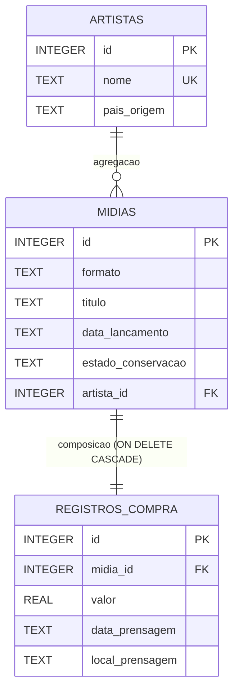

# GrooveManager

Sistema em Python, executado no terminal, para catalogar acervos de mídias físicas
(discos de vinil, CDs e fitas cassete). Projeto da disciplina de Orientação a
Objetos (UnB FGA).

> Status: Desk App III. Os dados são salvos em um banco de dados SQLite
> (`groovemanager.db`), criado automaticamente na primeira execução.

## Funcionalidades

- Cadastrar mídias (vinil, CD ou fita cassete) com validação de título, ano,
  artista, estado de conservação e valor pago
- Registro de compra de cada mídia: valor, data e local de prensagem
- Artista cadastrado junto com a mídia: o país é perguntado só na primeira vez
  e o mesmo artista é reaproveitado nos próximos álbuns
- Visualizar o acervo e ver a ficha técnica completa de uma mídia
- Buscar mídias por título, artista ou formato
- Editar o estado de conservação
- Remover mídia (com confirmação)
- Listar artistas (com país e quantidade de mídias no acervo)
- Pesquisar a mídia na Wikipedia
- Carregar dados de exemplo (opcional, sem duplicar o que já existe)
- **Persistência em banco de dados:** os dados continuam salvos ao fechar e
  abrir o programa
- Consultar o conteúdo bruto das tabelas do banco direto pelo menu

## Banco de dados

SQLite (biblioteca `sqlite3` do próprio Python, sem instalar nada). As operações
de banco acontecem no `RepositorioSQLite`:

| Ação no menu | Operação no banco |
|---|---|
| Abrir o programa | `SELECT` (carrega artistas e mídias salvos) |
| Cadastrar mídia / artista | `INSERT` |
| Editar estado de conservação | `UPDATE` |
| Remover mídia | `DELETE` |
| Consultar Banco de Dados (SQL) | `SELECT` em todas as tabelas |

As relações de POO aparecem no esquema:

- **Agregação:** `artistas` existe independente. Remover uma mídia não remove o
  artista.
- **Composição:** `registros_compra` depende de `midias`, com `ON DELETE CASCADE`.
  Remover a mídia remove o registro de compra junto.

## Conceitos de POO aplicados

- **Herança e polimorfismo:** Vinil, CD e K7 herdam da classe abstrata Midia e
  implementam `exibir_ficha_tecnica()` cada um do seu jeito
- **Composição:** cada mídia tem um RegistroCompra que só existe atrelado a ela
- **Agregação:** o Artista existe de forma independente e pode estar ligado a
  várias mídias; o Acervo também agrega mídias e artistas
- **Associação:** o Acervo usa um RepositorioSQLite para persistir os dados
- **Dependência:** BuscadorFichaTecnica e RepositorioSQLite recebem ou criam
  mídias apenas para usá-las
- **Encapsulamento:** atributos privados, protegidos e públicos com `@property`

## Como executar

Na pasta raiz do projeto:

    python main.py

O arquivo `groovemanager.db` é criado ao lado do `main.py`. Para começar do zero,
feche o programa e apague esse arquivo.

## Estrutura

    main.py
    models/   (Midia, Vinil, CD, K7, Artista, RegistroCompra, Acervo,
               BuscadorFichaTecnica, RepositorioSQLite)
    views/    (Menu, dados_exemplo)
    extras/   (versão 2 da Midia, usada só para comparação)

## Diagrama UML

