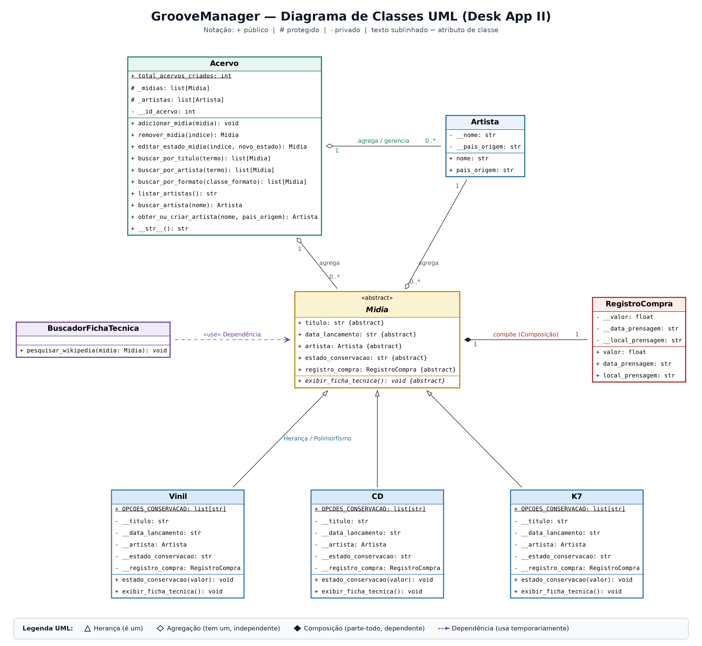

# GrooveManager

Sistema em Python, executado no terminal, para catalogar acervos de mídias físicas
(discos de vinil, CDs e fitas cassete). Projeto da disciplina de Orientação a
Objetos (UnB FGA).

> Status: Desk App II. Os dados ficam apenas na memória (RAM); a persistência em
> banco de dados fica para o Desk App III.

## Funcionalidades

- Cadastrar mídias (vinil, CD ou fita cassete) com validação de título, ano,
  artista, estado de conservação e valor pago
- Registro de compra de cada mídia: valor, data e local de prensagem
- Artista cadastrado junto com a mídia: o país é perguntado só na primeira vez
  e o mesmo artista é reaproveitado nos próximos álbuns
- Visualizar o acervo
- Ver a ficha técnica completa de uma mídia
- Buscar mídias por título, artista ou formato
- Editar o estado de conservação
- Remover mídia (com confirmação)
- Listar artistas (com país e quantidade de mídias no acervo)
- Pesquisar a mídia na Wikipedia
- Carregar dados de exemplo (opcional, para testes e demonstração)

## Conceitos de POO aplicados

- **Herança e polimorfismo:** Vinil, CD e K7 herdam da classe abstrata Midia e
  implementam `exibir_ficha_tecnica()` cada um do seu jeito
- **Composição:** cada mídia tem um RegistroCompra que só existe atrelado a ela
  (ao remover a mídia, o registro some junto)
- **Agregação:** o Artista existe de forma independente e pode estar ligado a
  várias mídias; o Acervo também agrega mídias e artistas. Ao remover uma mídia,
  o artista continua no acervo
- **Dependência:** BuscadorFichaTecnica recebe a mídia apenas como parâmetro
- **Encapsulamento:** atributos privados, protegidos e públicos com `@property`

## Como executar

Na pasta raiz do projeto:

    python main.py

## Estrutura

    main.py
    models/   (Midia, Vinil, CD, K7, Artista, RegistroCompra, Acervo, BuscadorFichaTecnica)
    views/    (Menu, dados_exemplo)
    extras/   (versão 2 da Midia, usada só para comparação)

## Diagrama UML

